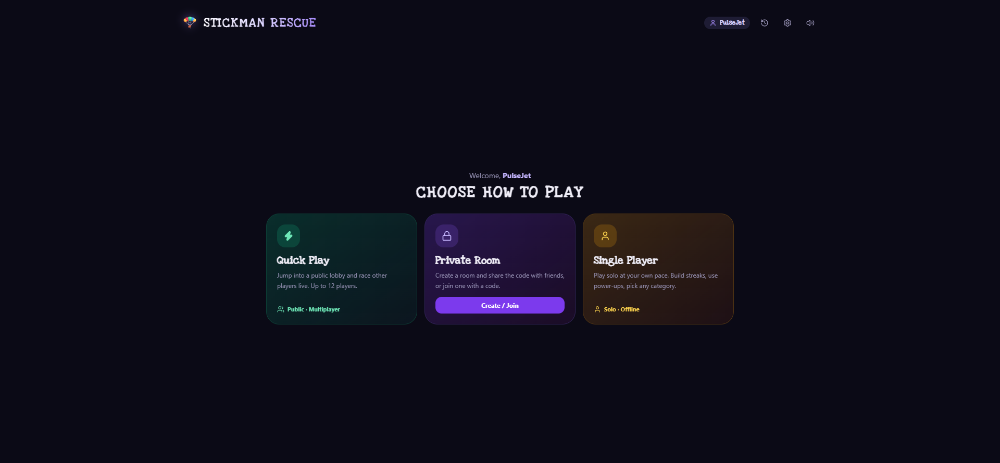
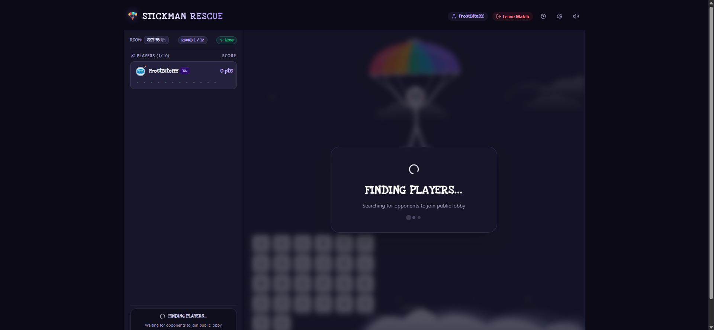

<div align="center">

# 🪂 STICKMAN RESCUE
### Rainbow Cloud Jumper // Cybernetic Word Puzzle

[](https://nextjs.org/)
[](https://www.typescriptlang.org/)
[](https://tailwindcss.com/)
[](https://developer.mozilla.org/en-US/docs/Web/API/WebSocket)
[](LICENSE)

<p align="center">
  <strong>An ultra-fast, cybernetic multiplayer word puzzle game built for the modern web.</strong><br>
  Guess letters, crack categorized secret codenames, preserve your parachute canopy, and guide your stickman safely down to the Cloud Haven.
</p>

[🎮 Play Live Online](https://hangman-online-with-friends.vercel.app) • [📖 Documentation](#-game-mechanics) • [🚀 Quick Start](#-getting-started) • [🤝 Contributing](#-contributing)

</div>

---

## 📸 Visual Tour

<div align="center">

### 1. Main Menu // Choose How to Play
Seamless drop-in lobby with zero-friction anonymous authentication.
<br><br>


<br><br>

### 2. Live Multiplayer Lobby // Real-Time WebSocket Sync
Compete head-to-head with up to 12 players across synchronous rounds.
<br><br>


<br><br>

### 3. Gameplay Center Stage // Parachute Physics & Virtual Neon Keyboard
Responsive keyboard controls, interactive letter blocks, and procedural audio synthesis.
<br><br>


</div>

---

## ⚡ Core Highlights

- **⚡ Sub-Millisecond Multiplayer Sync**: Native dual-channel architecture using WebSockets (`ws://`) with graceful, zero-downtime Server-Sent Events (SSE) and HTTP polling fallback.
- **🎹 100% Procedural Web Audio Engine**: Zero MP3s or WAV assets downloaded over the wire. Ticks, alarms, canopy snaps, background ambient drones, and victory fanfares are synthesized live via the Web Audio API.
- **🎨 Minimal Cybernetic Aesthetics**: Dark mode palette with glowing neon accents, bouncy SVG cloud physics, and hand-drawn sticker avatars.
- **🔤 Rich Curated Word Catalog**: Over 1,000+ words across Gaming, Sci-Fi, Pop Culture, Technology, Movies, and World History.
- **🔒 Zero-Auth Anonymous Sessions**: No registration or login wall required. Instant ephemeral player UUIDs stored in localStorage with random operative aliases.
- **📱 Fully Responsive**: Fluid layouts engineered for mobile touchscreens, tablets, and desktop mechanical keyboards.

---

## 🕹️ Game Mechanics

```
  +-------------------------------------------------------------------------+
  |                             STICKMAN RESCUE                             |
  |                                                                         |
  |     🪂  [ CANOPY HEALTH: 6 STRUTS ] ---> Each wrong guess breaks 1 strut|
  |      |                                                                  |
  |      v                                                                  |
  |   [ _ _ _ _ _ _ _ ]  ---> Crack the secret word before struts reach 0   |
  |                                                                         |
  |   ☁️  [ CLOUD SAFETY HAVEN ] ---> Safe landing on successful solve!      |
  +-------------------------------------------------------------------------+
```

### Modes of Play

| Mode | Description | Max Players | Network Requirement |
|:---|:---|:---:|:---|
| **Quick Play** | Jump directly into an open matchmaking queue and race opponents. | 12 | WebSocket / Online |
| **Private Room** | Generate a custom 6-character room code to invite friends. | 12 | WebSocket / Online |
| **Solo Mode** | Play at your own pace with category selection and personal streak records. | 1 | Completely Offline |

### Rules & Scoring

1. **Canopy Health**: The stickman descends with 6 protective parachute cords.
2. **Mistake Deductions**: Every incorrect letter guess snaps one cord and triggers an acoustic tension alert.
3. **Streak Multipliers**: Solving words consecutively in Solo mode ramps up streak multipliers (+1.5x, +2.0x).
4. **Multiplayer Race**: In Multiplayer lobbies, points are weighted by speed—first player to reveal the word earns a speed bonus!

---

## 📂 Project Architecture

```
whisper-game/
├── public/
│   └── screenshots/              # Real gameplay demonstration previews
├── server/
│   └── multiplayer_ws.js         # Standalone low-latency WebSocket hub (Port 3001)
├── src/
│   ├── app/
│   │   ├── api/                  # Next.js App Router API endpoints & SSE streams
│   │   ├── globals.css           # Tailwind custom animations & cybernetic tokens
│   │   ├── layout.tsx            # Root HTML & font configurations
│   │   └── page.tsx              # Game viewport entry point
│   ├── components/
│   │   └── cyber_rescue/         # Modular stickman, clouds, keyboard & modals
│   ├── hooks/
│   │   ├── useMultiplayerRescue  # Real-time WebSocket room hook
│   │   └── useWhisperGame        # Core local gameplay state machine
│   └── lib/
│       ├── cyber_rescue/         # Word catalogs, scoring math & room engines
│       └── audio.ts              # Procedural Web Audio API sound synthesizer
├── tests/
│   ├── e2e/                      # End-to-end integration test suites
│   └── unit/                     # Vitest unit test suites
├── LICENSE                       # MIT Open Source License
├── package.json                  # Dependencies & execution scripts
└── tailwind.config.ts            # Theme palette & screen breakpoints
```

---

## 🛠️ Tech Stack & Dependencies

- **Core Framework**: [Next.js 14](https://nextjs.org/) (App Router, Server Actions, Dynamic API Routes)
- **UI & Styling**: [React 18](https://react.dev/), [Tailwind CSS 3.4](https://tailwindcss.com/), [Framer Motion](https://www.framer.com/motion/)
- **Icons**: [Lucide React](https://lucide.dev/)
- **Real-Time Transport**: [ws (Node.js WebSocket)](https://github.com/websockets/ws)
- **Audio Generation**: Native Browser Web Audio API (`AudioContext`, `OscillatorNode`, `GainNode`)
- **Testing Engine**: [Vitest](https://vitest.dev/), [@testing-library/react](https://testing-library.com/)
- **Quality & Linting**: ESLint, TypeScript Strict Mode

---

## 🚀 Getting Started

### Prerequisites

Ensure you have the following installed locally:
- **Node.js**: `v18.18.0` or higher
- **Package Manager**: `pnpm` (recommended), `npm`, or `yarn`

### 1. Clone the Repository

```bash
git clone https://github.com/nothin618-boop/hangman_online_with_friends.git
cd hangman_online_with_friends
```

### 2. Install Dependencies

```bash
pnpm install
```

### 3. Run Locally

```bash
pnpm run dev
```

Visit **[http://localhost:3000](http://localhost:3000)** in your browser.  
The live multiplayer WebSocket server automatically launches on port `3001` alongside Next.js.

### 4. Run Test Suites

```bash
# Run unit tests
pnpm run test:unit

# Run full test suite
pnpm run test:all
```

---

## 🌐 Deployment

### Option A: 1-Click Deploy to Vercel (Recommended)

The easiest way to deploy the application for 24/7 global access:

[](https://vercel.com/new/clone?repository-url=https%3A%2F%2Fgithub.com%2Fnothin618-boop%2Fhangman_online_with_friends)

1. Sign in to [Vercel](https://vercel.com).
2. Click **Add New** > **Project** and import this repository.
3. Click **Deploy**. Vercel will handle optimized static builds and serverless APIs automatically.

### Option B: Deploy with Docker / Render

For persistent Node.js instances with native port 3001 WebSocket binding:

```bash
pnpm run build
pnpm run start
```

---

## 🤝 Contributing

Contributions make the open-source community a fantastic place to learn, inspire, and create! Any contributions you make are **greatly appreciated**.

1. Fork the Project
2. Create your Feature Branch (`git checkout -b feature/AmazingFeature`)
3. Commit your Changes (`git commit -m 'feat: Add some AmazingFeature'`)
4. Push to the Branch (`git push origin feature/AmazingFeature`)
5. Open a Pull Request

Please review [CONTRIBUTING.md](CONTRIBUTING.md) for details on code style and testing standards.

---

## 📄 License

Distributed under the **MIT License**. See [`LICENSE`](LICENSE) for more information.

---

<div align="center">
  <sub>Built with ❤️ for gamers, word-puzzle fans, and open-source enthusiasts.</sub>
</div>
