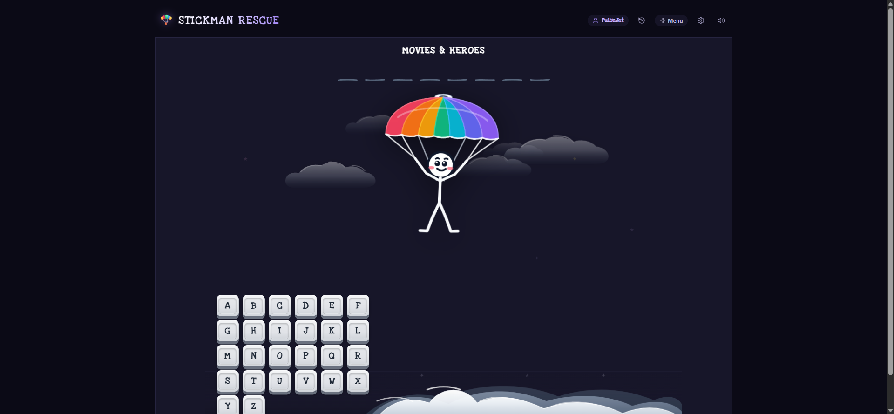

# 🪂 Stickman Rescue: Rainbow Cloud Jumper (Hangman Online)

An engaging, real-time multiplayer cybernetic word-puzzle game built with **Next.js 14**, **React 18**, **Tailwind CSS**, **TypeScript**, and **WebSockets**. Play solo or compete live with friends to rescue the stickman operative through cloud safety havens!

---

## 🎮 Game Screenshots

### 1. Main Menu — Choose How to Play


### 2. Live Multiplayer Lobby & Room Sync


### 3. Single Player Word Puzzle & Rescue Haven


---

## ✨ Features

- 🌐 **Real-Time Multiplayer**: Quick-play lobby, private room codes (up to 12 players), and live opponent score updates via native WebSockets with automatic HTTP/SSE fallback.
- 🎯 **Solo Mode**: Single-player practice mode with customizable categories (Gaming, Movies, Pop Culture, and more).
- 🔊 **Procedural Web Audio Engine**: Zero external audio downloads. All sound effects, heartbeat pulses, victory fanfares, and alarms are synthesized in real-time via the Web Audio API.
- ☁️ **Interactive Animations**: Dynamic cloud bounces, parachute float mechanics, and glowing neon virtual keyboards.
- 📱 **Mobile & Desktop Responsive**: Beautiful cybernetic dark-mode layout optimized across all screen sizes.
- ⚡ **Zero Setup Authentication**: Instant anonymous drop-in play with generated operative codenames.

---

## 🛠️ Tech Stack

| Layer | Technology |
|---|---|
| **Framework** | Next.js 14 (App Router) |
| **Frontend** | React 18, Tailwind CSS, Lucide Icons, Framer Motion |
| **Language** | TypeScript |
| **Realtime** | WebSocket (`ws`) & Server-Sent Events (SSE) |
| **Audio** | Native Web Audio API |
| **Deployment** | Vercel / Render / Docker |

---

## 📦 Getting Started

### Prerequisites

- Node.js (v18.18 or higher)
- pnpm (recommended) or npm

### Installation

```bash
# Clone the repository
git clone https://github.com/nothin618-boop/hangman_online_with_friends.git

# Enter the directory
cd hangman_online_with_friends

# Install dependencies
pnpm install
```

### Running Locally

```bash
# Start development server
pnpm run dev
```

Open [http://localhost:3000](http://localhost:3000) in your browser. The WebSocket server starts automatically on port 3001.

### Building for Production

```bash
pnpm run build
pnpm run start
```

---

## 🌐 Deploy to Vercel (1-Click Free Hosting)

1. Fork or push this repository to your GitHub account.
2. Sign in to [Vercel](https://vercel.com) with GitHub.
3. Click **Add New Project** and select `hangman_online_with_friends`.
4. Click **Deploy**. Vercel will build and host your game for free with automatic SSL.

---

## 🤝 Contributing

Contributions are welcome! Please feel free to open issues or submit pull requests. See [CONTRIBUTING.md](CONTRIBUTING.md) for details.

---

## 📄 License

This project is open-source and available under the [MIT License](LICENSE).
